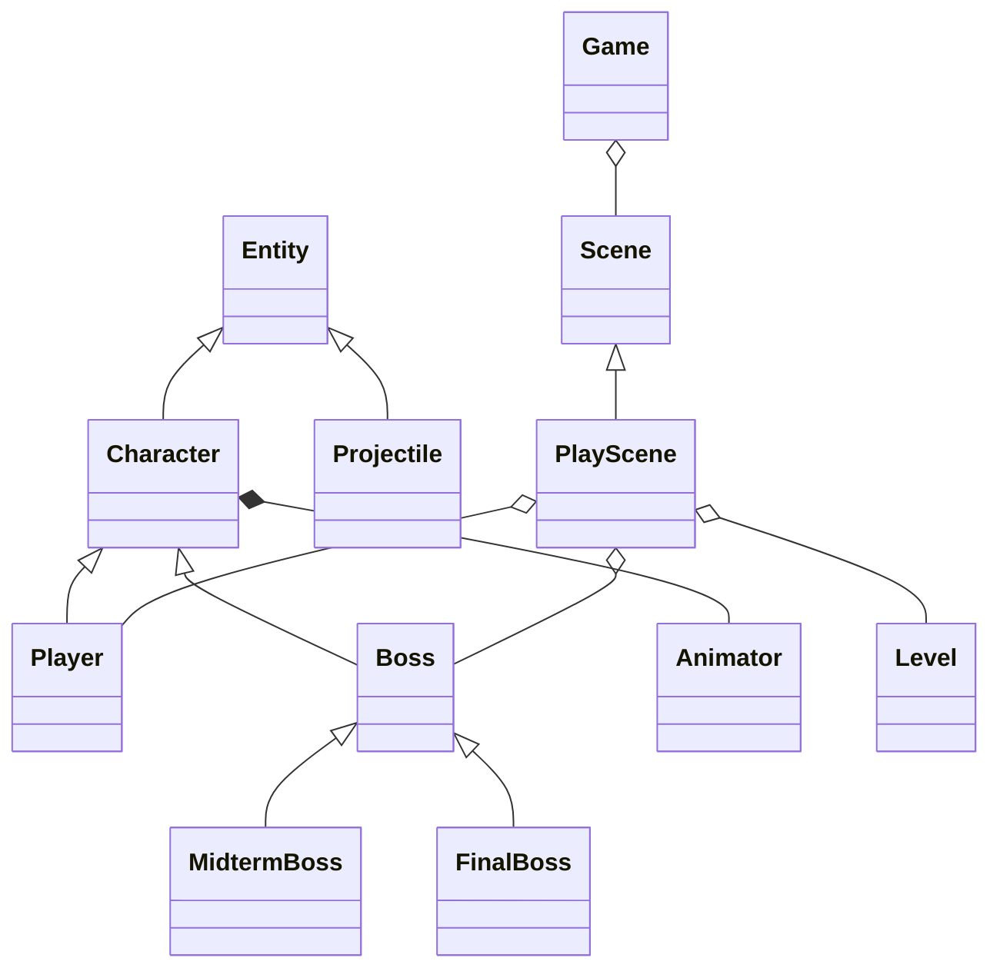

# ออกแบบโครงสร้าง OOP — AJ Jack

เอกสารนี้เป็น **แบบออกแบบ ยังไม่ได้เปลี่ยนโค้ดเกม** สำหรับโปรเจกต์ Pygame วิชา OOP โดยต่อยอดจากต้นแบบใน `main.py`, `game/assets.py` และ `game/settings.py` ปัจจุบัน ตัวอย่างด้านล่างเป็นโครงสร้างที่เสนอ ชื่อไฟล์ใหม่ยังไม่มีจริง

## แนวทางเกม

วางโครงสร้างให้รองรับเกม 2D side-scrolling ที่นักศึกษาใช้อาวุธคีย์บอร์ด ต่อสู้กับบอส Midterm และ Final มีเดิน กระโดด หลบ แพร์รี่ ฮีล และยิงปุ่มคีย์บอร์ด โดยยังปรับกติกาจริงได้ภายหลัง ต้นแบบปัจจุบันเดินได้สองแกนอย่างอิสระ ยังไม่มีแรงโน้มถ่วงหรือพื้น จึงต้องตัดสินใจและเพิ่มระบบเหล่านี้เมื่อเปลี่ยนเป็น side-scrolling

## โครงสร้างไฟล์ที่เสนอ

```text
main.py                    # สร้าง Game และเรียก run()
game/
  settings.py              # ค่าคงที่และตำแหน่งไฟล์ (มีแล้ว)
  assets.py                # โหลด atlas, เสียง, ฟอนต์ (มีแล้ว)
  game.py                  # game loop, หน้าจอ, เปลี่ยน scene
  animation.py             # Animator เลือกและเล่นเฟรม
  scenes/
    base.py                # Scene interface
    menu.py                # เมนู (เพิ่มภายหลัง)
    play.py                # ฉากเล่น ประสานผู้เล่น ศัตรู และ collision
  entities/
    entity.py              # Entity: ตำแหน่งและพื้นที่ชน
    character.py           # Character: พลังชีวิตและการรับความเสียหาย
    player.py              # Player: ควบคุมและท่าของผู้เล่น
    boss.py                # Boss, MidtermBoss, FinalBoss
    projectile.py          # Projectile และการเคลื่อนที่ของกระสุน
  world/
    level.py               # พื้น ฉาก และจุดเกิด
    camera.py              # เลื่อนมุมมองตามผู้เล่น
  ui/
    hud.py                 # แสดง HP และข้อมูลบนจอ
assets/                    # ใช้โครงสร้าง assets เดิม
```

ไม่จำเป็นต้องสร้างทุกไฟล์ตั้งแต่แรก เริ่มจาก Game, Player และ Animator ก่อน แล้วเพิ่มตามฟีเจอร์ที่ทำจริง

## ความรับผิดชอบของคลาส

| คลาส | หน้าที่และข้อมูลสำคัญ | เมธอดตัวอย่าง |
|---|---|---|
| `Game` | ดูแลหน้าต่าง, clock, scene ปัจจุบัน และ game loop | `run()`, `change_scene()` |
| `Scene` | สัญญาร่วมของแต่ละหน้าจอ | `handle_event(event)`, `update(dt)`, `draw(surface)` |
| `PlayScene` | สร้างและประสานผู้เล่น บอส ด่าน กระสุนและ HUD รวมถึงตรวจการชนระหว่างวัตถุ | `handle_event(event)`, `update(dt)`, `draw(surface)` |
| `Entity` | ตำแหน่ง ความเร็ว hitbox และสถานะมีชีวิตของวัตถุในโลก | `update(dt)`, `draw(surface, camera)` |
| `Character(Entity)` | พลังชีวิตสูงสุด/ปัจจุบัน การรับความเสียหาย และตาย | `take_damage(amount)`, `die()` |
| `Player(Character)` | ควบคุมตัวละคร ทิศที่หัน และสถานะการเคลื่อนไหว/ต่อสู้ | `handle_input(keys)`, `jump()`, `attack()`, `dodge()`, `parry()`, `heal()` |
| `Boss(Character)` | พฤติกรรมร่วมของบอส เช่น เลือกท่าและ cooldown | `choose_attack()`, `update_ai(dt)` |
| `MidtermBoss`, `FinalBoss` | กำหนดรูปแบบโจมตีและพฤติกรรมเฉพาะแต่ละร่าง | override `choose_attack()` หรือ `update_ai(dt)` |
| `Projectile(Entity)` | เจ้าของ ทิศ ความเร็ว ความเสียหาย และอายุของกระสุน | `update(dt)`, `on_hit(target)` |
| `Animator` | เก็บแอนิเมชันปัจจุบัน เวลา FPS และเลือกภาพ/anchor ของเฟรม | `play(name)`, `update(dt)`, `current_frame()` |
| `Level` | ข้อมูลพื้น ผนัง ฉากหลัง จุดเกิด และพื้นที่ฉาก | `draw(surface, camera)`, `get_collision_rects()` |
| `Camera` | แปลงตำแหน่งโลกเป็นตำแหน่งบนจอและติดตามผู้เล่น | `follow(target)`, `apply(rect)` |
| `HUD` | วาด HP และสถานะที่จำเป็น | `draw(surface, player, boss)` |



ใช้ inheritance เมื่อเป็นความสัมพันธ์แบบ “เป็นชนิดหนึ่งของ” และใช้ composition เมื่อเป็น “มี/ใช้งาน” เช่น Player เป็น Character แต่มี Animator; ไม่จำเป็นต้องบังคับทุกอย่างเป็นคลาส ใช้ฟังก์ชันโหลด asset ที่มีอยู่ต่อได้

## ลำดับทำงานต่อเฟรม

1. `Game.run()` รับ event; ปิดเกมเมื่อ `QUIT` และส่ง event ให้ scene
2. `PlayScene` รับ input แล้วสั่ง Player; ใช้ `pygame.key.get_pressed()` สำหรับปุ่มค้าง และ event สำหรับการกดครั้งเดียว เช่น กระโดด
3. `PlayScene.update(dt)` อัปเดตผู้เล่น บอส กระสุน แอนิเมชัน และกล้อง ตรวจการชนกับพื้นและระหว่างการโจมตีกับเป้าหมาย แล้วนำวัตถุที่หมดอายุออก
4. `PlayScene.draw(surface)` วาดฉาก ตัวละคร เอฟเฟกต์ และ HUD; `Game` เรียก `pygame.display.flip()`

ใช้ `dt` เป็นวินาทีเหมือนต้นแบบ (`clock.tick(FPS) / 1000`) และเก็บพิกัดโลกแยกจากพิกัดบนหน้าจอ; กล้องมีผลเฉพาะการวาด ไม่แก้ตำแหน่งโลกหรือ hitbox จริง

## แนวทางระบบต่อสู้

- แยก **hitbox ตัวละคร** สำหรับรับความเสียหายออกจาก **พื้นที่โจมตี** ที่เปิดเฉพาะเฟรมโจมตีที่มีผล เพื่อไม่ให้ภาพขนาดต่างกันทำให้ชนผิด
- การโจมตีหนึ่งครั้งควรติดตามเป้าหมายที่โดนไปแล้ว เพื่อไม่ให้โดนซ้ำทุกเฟรมโดยไม่ตั้งใจ; กำหนดความเสียหายจาก `owner`, ป้องกันยิงโดนฝ่ายตัวเอง และลบ projectile เมื่อชนหรือหมดอายุ
- ใช้สถานะ เช่น idle, move, jump, attack, dodge, parry, hurt, dead พร้อมเงื่อนไขเปลี่ยนสถานะและช่วง cooldown / invulnerability ตามกติกาที่ทีมเลือก ไม่ต้องสร้าง state class แยกทุกท่าตั้งแต่แรก
- Midterm และ Final อาจเป็นบอสคนละ object โดย `PlayScene` เปลี่ยนร่างเมื่อเลือด Midterm หมด และควบคุมช่วงเปลี่ยนผ่าน; กำหนดว่าจะรีเซ็ตตำแหน่งหรือ HP อย่างไรภายหลัง

## เชื่อมกับโค้ดเดิม

1. ย้ายการสร้างหน้าต่าง, clock และ loop จาก `main.py` ไป `Game` โดยให้ `main.py` เหลือจุดเริ่มต้น
2. ย้าย position, velocity, facing, การเลือก idle/move และการวาดจาก `main.py` ไป `Player` กับ `Animator` รักษาความเร็วและ FPS เดิมก่อน
3. ใช้ `load_sprite_atlas()` และ `SpriteFrame.image/anchor` เดิม โหลด **หลัง** `pygame.display.set_mode()` เพราะใช้ `convert_alpha()`; เมื่อต้องกลับภาพให้ปรับ anchor แนวนอนเหมือนโค้ดปัจจุบัน และ scale anchor พร้อมภาพ
4. แยก `PlayScene` แล้วเพิ่มแรงโน้มถ่วง พื้น และ collision ก่อนเพิ่มกล้องกับระบบต่อสู้
5. เพิ่ม Player actions, projectile, บอส Midterm, การเปลี่ยนร่าง Final และ HUD ทีละส่วน พร้อมทดลองเล่นแต่ละขั้น

หมายเหตุ: `assets/sprites.json` มี `action_row_3` ที่ยังไม่ระบุท่า จึงไม่ควรสมมติว่าเป็น dodge หรือ parry จนกว่าจะตรวจสไปรต์และตกลงในทีม การใช้ atlas ตอนนี้ชื่อแอนิเมชันต้องไม่ซ้ำกัน และ path ต้องตรงกับไฟล์จริง

## ตัวอย่าง interface แบบย่อ

```python
from abc import ABC, abstractmethod

class Scene(ABC):
    @abstractmethod
    def handle_event(self, event):
        pass

    @abstractmethod
    def update(self, dt):
        pass

    @abstractmethod
    def draw(self, surface):
        pass
```

`@abstractmethod` บังคับให้คลาสลูกเติมเมธอดที่จำเป็นก่อนสร้าง instance เหมาะกับ `Scene` ที่มีหลายหน้าจอ แต่ไม่จำเป็นต้องใช้กับทุกคลาส

## อัปเดตการ setup

ปัจจุบันเริ่ม implement แล้ว: `Game`, `Entity`, `Player`, `Animator`, `Renderer` และ `Controller` โดย `PlayerController`, `BossController`, `BossChildController` สืบทอดจาก `Controller` ตามที่ระบุใน README ส่วนโครงสร้างไฟล์และคลาสอื่นข้างต้นยังเป็นข้อเสนอสำหรับพัฒนาต่อ บอสและลูกสมุนยังไม่มีพฤติกรรมหรือปรากฏในเกม
